# ¿Qué hay en la foto?

Tomas una foto con el teléfono, la subes, y en un par de segundos la aplicación te dice qué ve en ella, con un porcentaje al lado de cada cosa. La foto queda guardada en un bucket de Cloud Storage y aparece en una galería con las últimas fotos del grupo. Quien reconoce lo que hay en la imagen no es código tuyo: es Cloud Vision, un modelo que Google ya entrenó y que se usa con una petición HTTP.

La plantilla trae las dos aplicaciones completas y la infraestructura del frontend y el backend. Tu grupo construye en Terraform el bucket, el permiso del backend sobre él y el acceso a Vision.

| Sin bucket todavía | Con etiquetas | La galería |
|---|---|---|
| 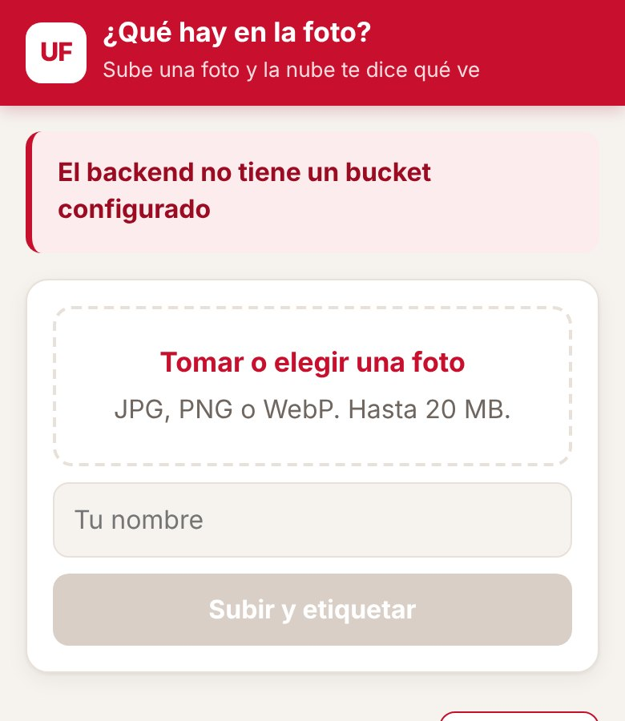 | 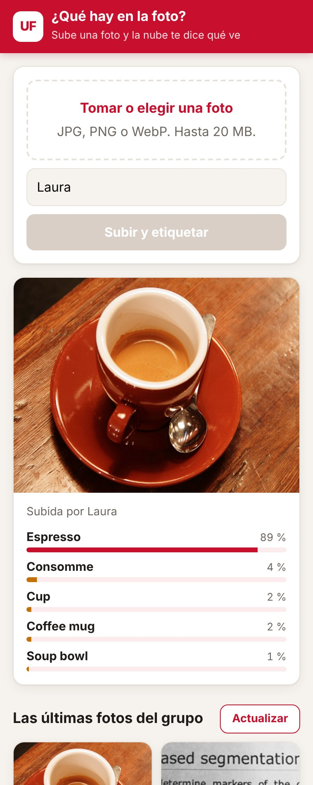 | 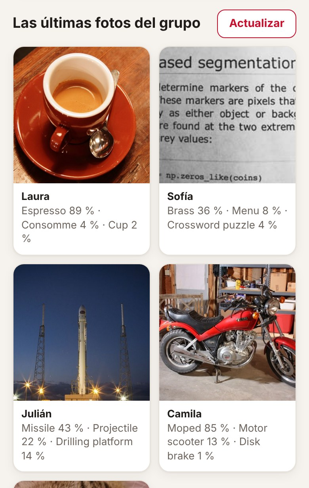 |

Las capturas salen de una prueba local: Cloud Storage simulado y, en lugar de Vision, un modelo de clasificación pequeño corriendo en el computador. Por eso las etiquetas de las capturas no son las de Vision; las reales las vas a ver cuando lo despliegues.

## Arquitectura al terminar la práctica

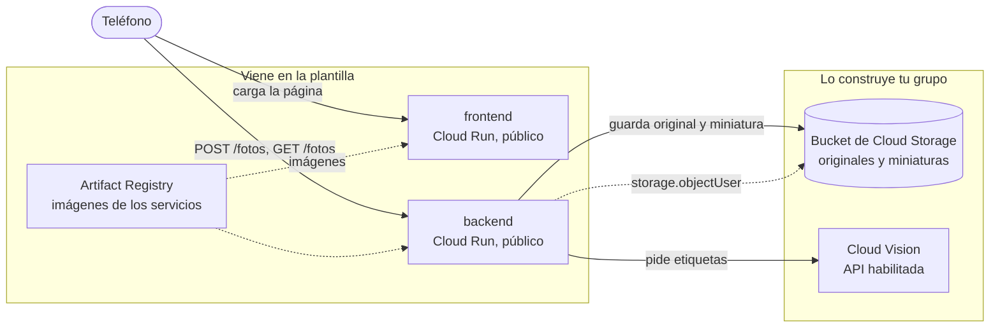

La flecha punteada es el único permiso de IAM que da tu grupo: la cuenta del backend puede crear, leer y listar objetos en ese bucket y en ningún otro. Para llamar a Vision no hace falta ningún rol: basta con que la API esté habilitada en el proyecto y con que el backend corra con una cuenta de servicio del mismo proyecto.

En la plantilla, la variable `BUCKET` del backend está vacía: responde que no tiene dónde guardar y no guarda nada. Es lo primero que vas a ver al desplegar.

## Estructura del repositorio

```
backend/main.py            API en Flask: recibe la foto, hace la miniatura, pide etiquetas y guarda en el bucket
backend/requirements.txt   Dependencias del backend con versión fija
backend/Dockerfile         Imagen del backend con gunicorn
frontend/index.html        La página: subir una foto, ver sus etiquetas y la galería del grupo
frontend/server.py         Servidor sin dependencias que inyecta BACKEND_URL en la página
frontend/Dockerfile        Imagen del frontend
infra/providers.tf         Versión de Terraform y del proveedor de Google
infra/variables.tf         Proyecto, prefijo, región e imágenes
infra/main.tf              APIs, registro, backend y frontend con sus cuentas
infra/outputs.tf           Ruta del registro y URL de los servicios
infra/terraform.tfvars.example   Ejemplo de valores; cópialo como terraform.tfvars
docs/api.md                Endpoints del backend y cómo se guardan las fotos
docs/capturas/             Capturas de la aplicación usadas en este README
.gitignore                 Deja por fuera el estado de Terraform, tus tfvars y __pycache__
```

## Cómo empezar

### Flujo de trabajo

1. Crea el repositorio de tu grupo con **Use this template** en GitHub.
2. Edita en VS Code o en github.dev (tecla `.` en la página del repositorio).
3. Haz commit y push desde el editor.
4. En Cloud Shell clonas la primera vez y traes los cambios con `git pull` después. Desde Cloud Shell nunca haces push.
5. Docker y Terraform se ejecutan siempre en Cloud Shell. La consola de Google Cloud es para mirar y diagnosticar, no para crear recursos.

### Primer despliegue

En Cloud Shell:

```bash
git clone https://github.com/<tu-usuario>/<tu-repositorio>.git
cd <tu-repositorio>/infra
cp terraform.tfvars.example terraform.tfvars
cloudshell edit terraform.tfvars
```

En `terraform.tfvars` pon el ID de tu proyecto y el prefijo del grupo, y ajusta las rutas de las imágenes a esos mismos valores. Este archivo vive solo en Cloud Shell: el `.gitignore` evita que llegue a GitHub.

El orden importa, porque las imágenes necesitan el registro y los servicios necesitan las imágenes:

```bash
# 1. Solo el registro (y las APIs de las que depende)
terraform init
terraform apply -target=google_artifact_registry_repository.registro

# 2. Las imágenes
REGISTRO=$(terraform output -raw registro)
gcloud auth configure-docker us-central1-docker.pkg.dev --quiet
cd ..
docker build -t $REGISTRO/backend:v1 backend
docker push $REGISTRO/backend:v1
docker build -t $REGISTRO/frontend:v1 frontend
docker push $REGISTRO/frontend:v1

# 3. Todo lo demás
cd infra
terraform apply
terraform output
```

Abre `url_frontend` en el teléfono. Si usas otra región, cambia `us-central1` en el comando de `gcloud auth configure-docker`, y ten en cuenta que la cuota gratuita de Cloud Storage solo aplica en `us-central1`, `us-east1` y `us-west1`.

Cuando cambies el código de un servicio, construye y sube la imagen con una etiqueta nueva (`v2`, `v3`...), actualízala en `terraform.tfvars` y vuelve a aplicar. Si subes otra vez la misma etiqueta, Terraform no ve ningún cambio y Cloud Run sigue con la versión anterior.

## Probar cada servicio con `docker run`

Antes de subir una imagen, pruébala en Cloud Shell. Para ver una página servida en Cloud Shell usa **Vista previa en la Web** y elige el puerto.

**Frontend.** No necesita credenciales:

```bash
docker run --rm -p 8080:8080 -e BACKEND_URL=https://<url-del-backend> $REGISTRO/frontend:v1
```

Abre la vista previa en el puerto 8080. Si no pasas `BACKEND_URL`, la página va a decir que no pudo hablar con el backend.

**Backend sin bucket.** El contenedor arranca aunque no tenga credenciales, y sin la variable `BUCKET` responde con un error claro:

```bash
docker run --rm -d --name backend -p 8081:8080 $REGISTRO/backend:v1
curl -i localhost:8081/fotos
docker logs backend
docker rm -f backend
```

Debe responder `503` con el error en JSON y una advertencia en los registros.

**Backend con bucket.** Cuando el bucket ya existe y la API de Vision está habilitada, puedes darle al contenedor tus propias credenciales:

```bash
gcloud auth application-default login
docker run --rm -d --name backend -p 8081:8080 \
  -e GOOGLE_CLOUD_PROJECT=<tu-proyecto> \
  -e BUCKET=<nombre-del-bucket> \
  -e GOOGLE_APPLICATION_CREDENTIALS=/adc.json \
  -v $HOME/.config/gcloud/application_default_credentials.json:/adc.json:ro \
  $REGISTRO/backend:v1
curl -X POST localhost:8081/fotos -F "autor=Ana" -F "foto=@una-foto.jpg"
curl localhost:8081/fotos
```

Los detalles de cada endpoint están en [docs/api.md](docs/api.md).

---

# Informe del grupo

## Integrantes

| Nombre | Código | Usuario de GitHub |
|---|---|---|
| Carlos Avendaño | 1152406 | [carloxavz](https://github.com/carloxavz) |
| Juan David Marciales Niebles | 1152431 | [JDmn195](https://github.com/JDmn195) |

Despliega Carlos, desde Cloud Shell con la cuenta `carlosantonioav@ufps.edu.co`, en el proyecto `nube-2026-ii`, con el prefijo `juandavid`.

## URL de la aplicación

Frontend: https://juandavid-frontend-24cnlwn55q-uc.a.run.app

Backend: https://juandavid-backend-24cnlwn55q-uc.a.run.app

## Diagrama propio

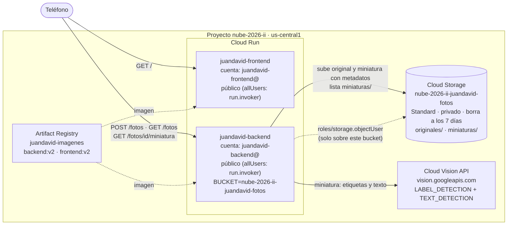

La flecha punteada de `roles/storage.objectUser` es el único permiso de IAM que agregamos: la cuenta `juandavid-backend@nube-2026-ii.iam.gserviceaccount.com` puede crear, leer, listar y borrar objetos en `nube-2026-ii-juandavid-fotos` y en ningún otro bucket. Para Vision no hay rol: basta con que la API esté habilitada en el proyecto.

## Evidencias por fase

### Fase 0. Preparación

El repositorio es público y tiene a los dos integrantes como colaboradores. `gcloud config list` en Cloud Shell muestra el proyecto de quien despliega:

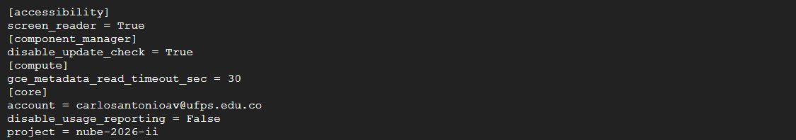

Antes de empezar revisamos las prácticas 4 y 5: su estado de Terraform estaba vacío y no quedaba ningún repositorio en Artifact Registry, así que no había nada que destruir.

### Fase 1. Registro, imágenes y primer despliegue

Las dos imágenes en Artifact Registry:

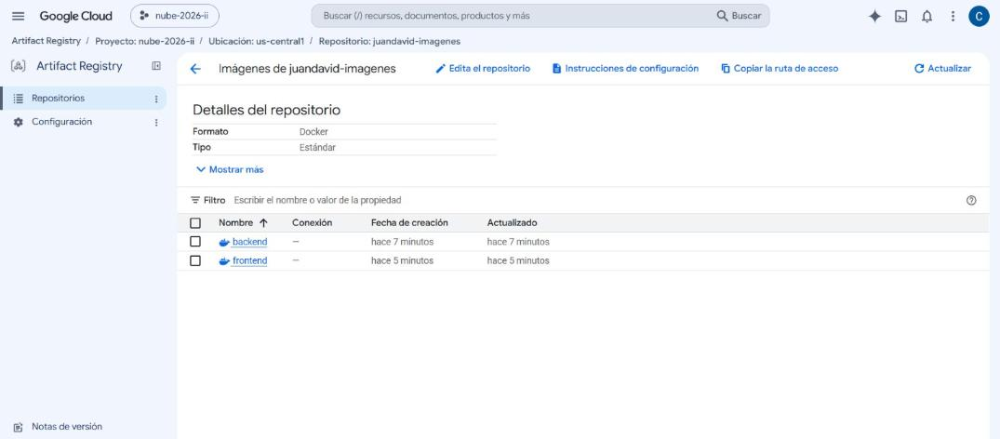

El `apply` completo y sus salidas:

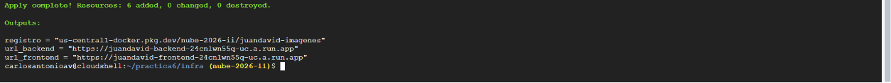

La página carga, pero avisa que el backend no tiene bucket:

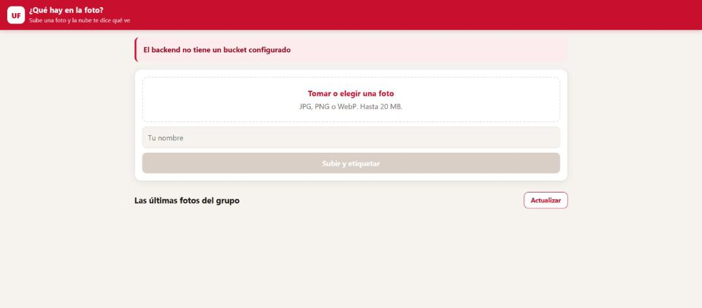

En los registros del backend, `GET /fotos` responde 503 y queda la advertencia `BUCKET está vacía: no hay dónde guardar las fotos`:

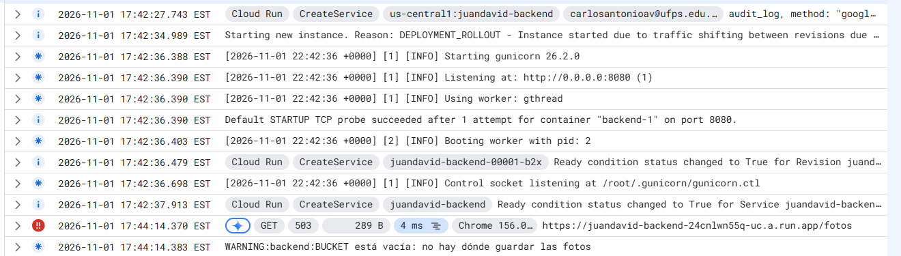

El `docker push` desde Cloud Shell falló varias veces con `dial tcp ...:443: connect: connection refused` hacia `us-central1-docker.pkg.dev`, aunque `curl` sí llegaba al registro. Era un fallo intermitente de red de Cloud Shell; con reintentos las dos imágenes subieron.

### Fase 2. El bucket

`infra/storage.tf` crea el bucket (región `var.region`, clase `STANDARD`, acceso uniforme, prevención de acceso público) y le da `roles/storage.objectUser` a `serviceAccount:${google_service_account.backend.email}`. En `main.tf` el backend recibe `BUCKET = google_storage_bucket.fotos.name`, y `outputs.tf` expone `bucket`. El plan fue 2 recursos nuevos y 1 cambio:

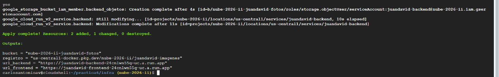

La foto se subió desde el teléfono y se guardó sin etiquetas:

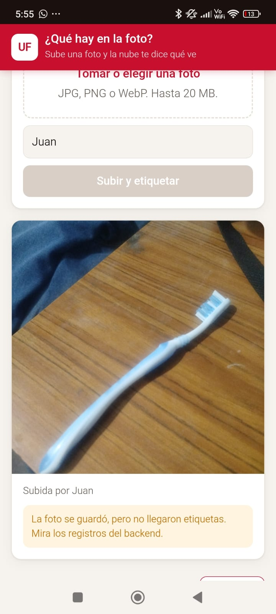

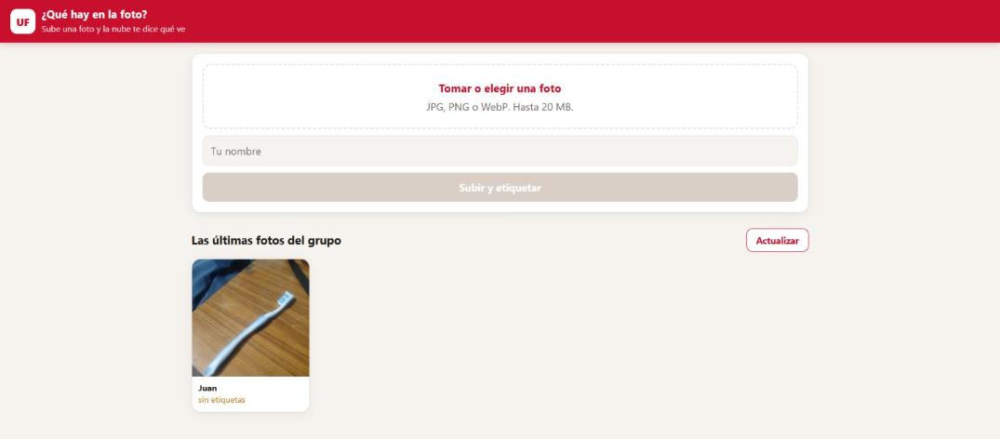

Los dos objetos de esa foto en el bucket: el original de 1,9 MB en `originales/` y la miniatura de 95,2 KB en `miniaturas/`:

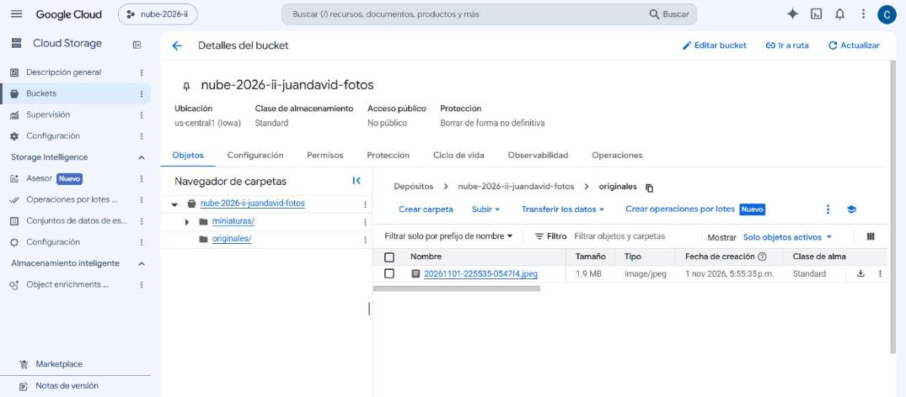


La advertencia del backend: `Vision no respondió: 403 Cloud Vision API has not been used in project 108015969075 before or it is disabled`:

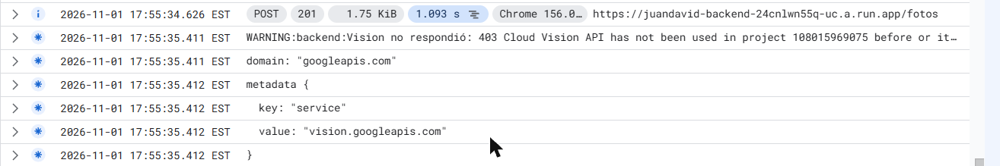

### Fase 3. Vision

Una línea en la lista de `google_project_service.apis`: `"vision.googleapis.com"`. El plan fue 1 recurso nuevo:

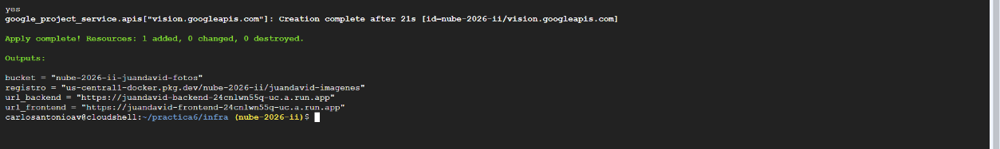

La API habilitada en la consola:

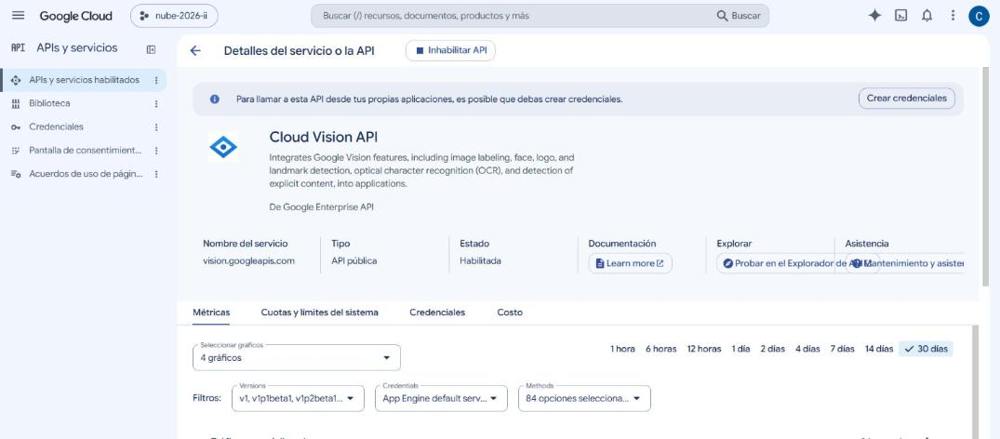

Las líneas del registro del backend con cada foto guardada y su número de etiquetas. La de la fase 2 tiene 0:

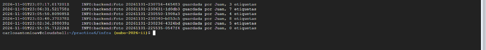

### Fase 4. Ponerlo a prueba

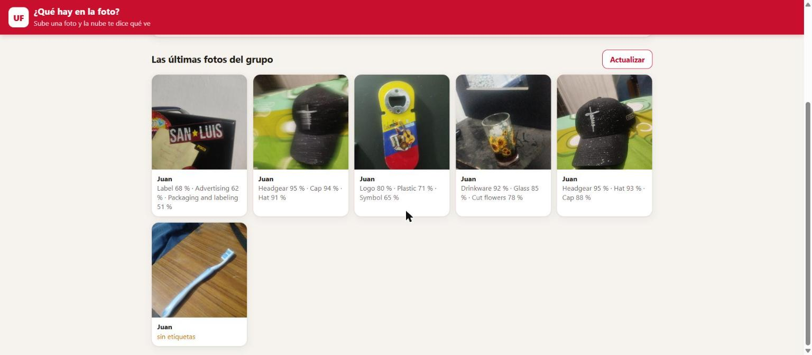

| # | Caso | Foto | Las tres primeras etiquetas | ¿Acertó? |
|---|---|---|---|---|
| 1 | Común y bien iluminado | Una gorra negra sobre la cama | Headgear 0,951 · Hat 0,926 · Cap 0,880 | Sí. Es un objeto muy común en internet y lo reconoce con más de 0,88 en las tres. |
| 2 | Típico de la región | Un abrebotellas de recuerdo con la bandera de Colombia y un acordeón | Logo 0,796 · Plastic 0,705 · Symbol 0,652 | A medias. Ve que es plástico con un logo, pero no dice que es un abrebotellas, ni reconoce la bandera ni el acordeón vallenato: a lo local no le pone nombre. No teníamos comida típica a la mano y usamos este recuerdo. |
| 3 | Dibujo | Un vaso con girasoles pintados | Drinkware 0,919 · Glass 0,851 · Cut flowers 0,778 | El vaso sí, pero confunde el dibujo con la cosa dibujada: cree que hay flores cortadas de verdad (más abajo aparecen Vase y Floristry). |
| 4 | Con texto | Una caja con el sello "SAN LUIS" | Label 0,683 · Advertising 0,616 · Packaging and labeling 0,507 | Ve que hay una etiqueta y publicidad, con confianza baja (las tres en ámbar), pero no lee lo que dice. Leer el texto es otra función (`text_detection`), que agregamos en el reto. |
| 5 | Lo mismo que la 1, movido | La misma gorra, movida y desenfocada | Headgear 0,954 · Cap 0,935 · Hat 0,911 | Sí, incluso con más confianza. El movimiento no alcanzó a confundirlo: la forma de una gorra se reconoce aunque esté borrosa. |

Lo que aprendimos: acierta con lo común aunque la foto esté movida, pero con lo local responde categorías genéricas (Logo, Symbol, Plastic) y con un dibujo describe lo dibujado como si fuera real.

### Fase 5. Mirar el bucket

`gcloud storage ls -l` de las dos "carpetas" y `gcloud storage objects describe` de una miniatura, con sus metadatos `autor`, `etiquetas` y `vision`:

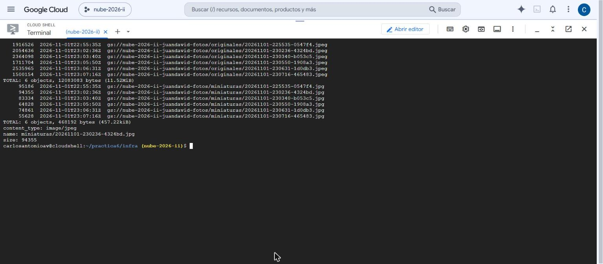

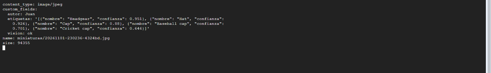

| Foto | Original | Miniatura | Proporción |
|---|---|---|---|
| `20261101-230236-4324bd` (la gorra) | 2.054.636 bytes (1,96 MiB) | 94.355 bytes (92 KiB) | 21,8 veces más liviana |
| Las 6 fotos de las fases 2 a 4 | 12.083.083 bytes (11,52 MiB) | 468.192 bytes (457 KiB) | 25,8 veces |

En promedio un original pesa 1,92 MiB y una miniatura 76 KiB. Como el backend solo sirve miniaturas, cada foto que se ve en la galería sale a unos 76 KiB y no a 2 MiB.

### Fase 6. Reto

Una foto con texto, vista en el teléfono, con el bloque "Texto que leyó Vision":

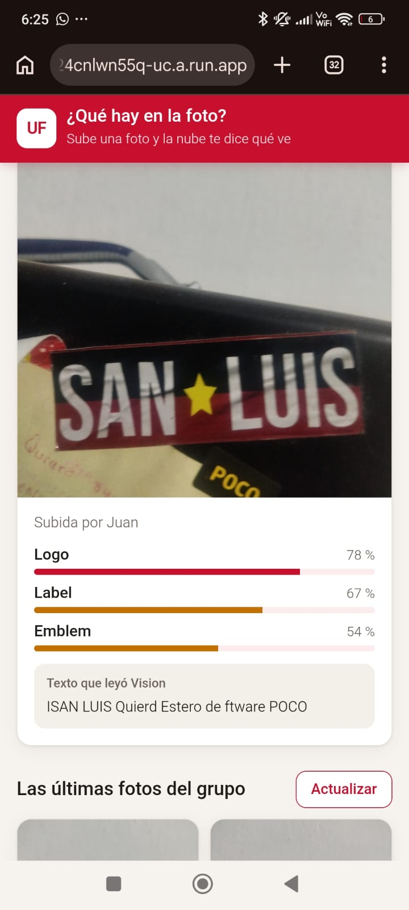

Y en la galería, debajo de las etiquetas:

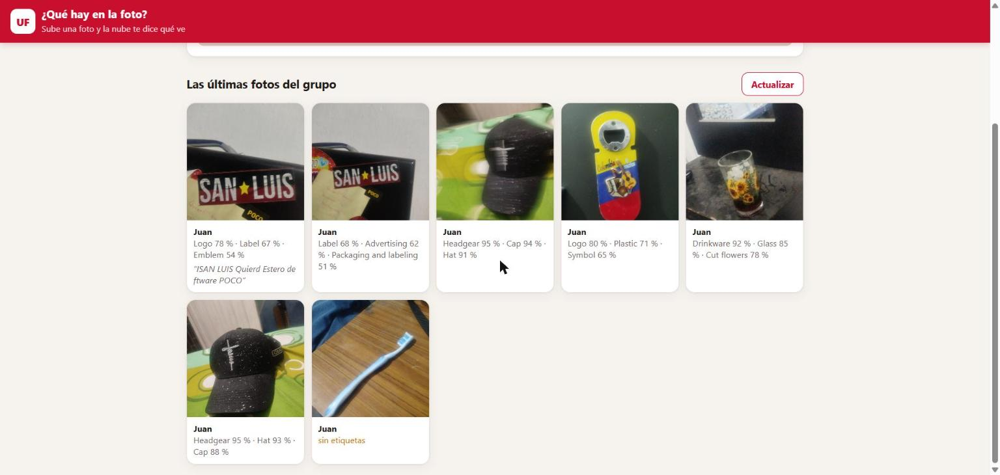

El despliegue de la versión 2 (imágenes `v2` y la regla de ciclo de vida, 3 cambios):

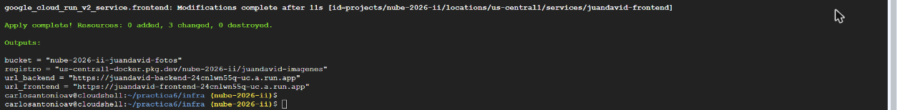

La regla de ciclo de vida en la consola del bucket: "Borrar objeto, 7 días o más desde que se creó el objeto":

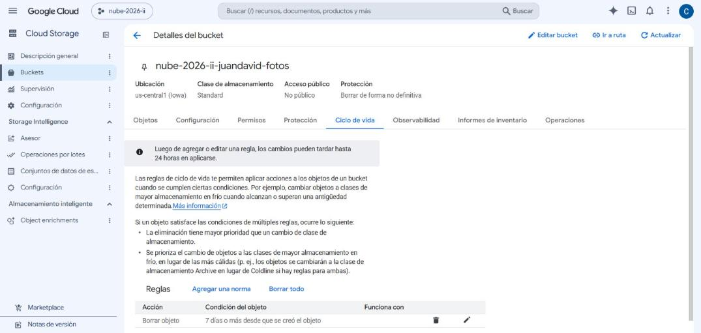

La reproducción desde cero está en [Cómo reproducimos](#4-cómo-reproducimos).

## Decisiones del reto

### 1. Leer el texto

**Qué cambiamos.** En `backend/main.py`, `etiquetar` ya no llama a `label_detection`: hace una sola petición `annotate_image` con dos funciones, `LABEL_DETECTION` (máximo 8) y `TEXT_DETECTION`. Son dos unidades de Vision por foto, pero una sola llamada HTTP. El texto se guarda como un cuarto metadato de la miniatura, `texto`, en la misma subida que los demás, así que sigue siendo una sola operación de clase A. `como_json` lo devuelve y el frontend lo muestra en el resultado ("Texto que leyó Vision") y en la galería, en cursiva y cortado a dos líneas.

**Qué guardamos cuando no hay texto.** Una cadena vacía, igual que `etiquetas` cuando Vision falla. Así el metadato existe siempre y el frontend oculta el bloque si está vacío. Las fotos anteriores al cambio no tienen el metadato, y `meta.get("texto", "")` las trata igual.

**Cuánto texto cabe.** Cloud Storage admite hasta 8 KiB de metadatos propios por objeto, sumando nombres y valores. Las etiquetas ocupan menos de 1 KiB. Juntamos los espacios y saltos de línea en uno solo y cortamos a 1.000 caracteres, con "…" al final si se pasa: en UTF-8 son a lo sumo unos 3 KB, con margen de sobra. Una página de cuaderno entera se pasaría de 8 KiB y la subida fallaría; por eso hay que cortar.

**Cómo lo comprobamos.** La caja "SAN LUIS", que en la fase 4 solo tenía `Label`, ahora trae `texto: "ISAN LUIS Quierd Estero de ftware POCO"`. Leyó bien las palabras grandes y se equivocó con lo pequeño y torcido. Las fotos sin texto, como la gorra, quedan con `texto` vacío y no muestran el bloque.

### 2. Limpieza automática

**Qué cambiamos.** Un bloque `lifecycle_rule` en `google_storage_bucket.fotos`, con `condition { age = 7 }` y `action { type = "Delete" }`. Aplica a todos los objetos, originales y miniaturas, así que los dos de una foto se borran juntos.

**Por qué 7 días.** Es una galería de "las últimas fotos del grupo", no un archivo. Con 1 día, las fotos de la clase desaparecerían antes de que el grupo terminara el informe o de la revisión. Con 30 días, el bucket guardaría cuatro veces más originales que nadie ve. Una semana cubre una semana de clase.

**Qué pasa con un objeto que se sube el día en que la regla corre.** `age` se cuenta en días completos desde la creación del objeto. Ese objeto tiene edad 0, no cumple la condición y no se toca; se borra en la primera pasada en que ya tenga 7 días o más. Cloud Storage evalúa las reglas de forma asíncrona, más o menos una vez al día, así que el borrado real ocurre entre el día 7 y el día 8.

**Cómo demostramos que existe y cómo comprobaríamos que funciona.** Existe: está en Terraform y en la consola (captura de la fase 6), y también se ve con `gcloud storage buckets describe gs://nube-2026-ii-juandavid-fotos --format="default(lifecycle_config)"`. Para ver que funciona sin esperar una semana a ciegas: listar hoy con `gcloud storage ls -l "gs://nube-2026-ii-juandavid-fotos/**"` y volver a listar después del 9 de noviembre: las fotos subidas el 1 de noviembre ya no deberían estar. Una prueba más rápida es un bucket de prueba en Terraform con la misma regla y `age = 0`: en las siguientes 24 horas se vacía solo.

### 3. La cuenta

Medidas reales de nuestro bucket: original promedio 2.013.847 bytes (1,92 MiB) y miniatura promedio 78.032 bytes (76 KiB), unos 2,09 MB por foto. Cuota gratuita mensual según la guía: 5 GB, 5.000 operaciones de clase A y 1.000 unidades de Vision. La salida de datos de Cloud Run hacia Colombia cuesta 0,19 USD por GiB, sin cuota gratuita.

| Recurso | Cuánto gasta una foto | Fotos al mes dentro de la cuota |
|---|---|---|
| Unidades de Vision | 2 (etiquetas y texto) | 1.000 / 2 = **500** |
| Operaciones de clase A | 2 subidas (original y miniatura) + 1 listado (la galería se recarga después de subir) = 3 | 5.000 / 3 ≈ 1.666. Si además cada foto provoca dos aperturas más de la galería, son 5 y quedan 1.000 |
| Espacio | 2,09 MB, pero con la regla solo viven unos 8 días de fotos (7 de la regla y hasta 1 de retraso) | 5 GB / (2,09 MB × 8/30) ≈ 8.970 |
| Salida de datos | 76 KiB cada vez que alguien ve la miniatura (la caché del navegador evita repetirla durante el día) | No hay cuota: se paga desde el primer byte. 500 fotos vistas por 10 personas son unos 0,36 GiB, unos 7 centavos de dólar |

**Se agota primero Vision, con 500 fotos al mes.** Antes del reto, con una sola unidad por foto, el límite era 1.000 y seguía siendo Vision, aunque ya cerca de las operaciones de clase A si la galería se abre seguido. Sin la regla de ciclo de vida, el espacio se acumularía y se acabaría después de unas 2.390 fotos en total. La salida de datos nunca es gratis, pero con miniaturas es muy barata: con originales costaría 25 veces más.

### 4. Cómo reproducimos

Hicimos `terraform destroy` y todo de nuevo desde cero, sin ningún paso a mano en la consola.

**Destroy.** El plan de destrucción listaba 14 recursos. El primer intento borró 5 y se cortó con un error de red de Cloud Shell al borrar el registro (`dial tcp [2607:...]:443: connect: cannot assign requested address`); el segundo `terraform destroy` borró los 9 restantes y el estado quedó vacío. El bucket se borró con sus 7 fotos adentro gracias a `force_destroy = true`. Sin esa línea, Terraform le pediría a Cloud Storage borrar un bucket que no está vacío, la API respondería error 409 (`The bucket you tried to delete is not empty`) y el destroy fallaría hasta vaciarlo a mano, que es justo un paso de consola que no queremos. Las APIs salen del estado pero siguen habilitadas, por `disable_on_destroy = false`.

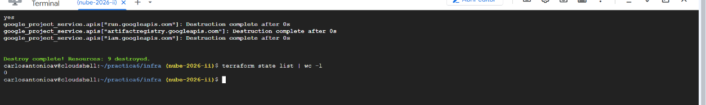

**Orden de creación.** No se puede aplicar todo de una vez, porque Cloud Run necesita que las imágenes existan y las imágenes necesitan el registro:

1. `terraform apply -target=google_artifact_registry_repository.registro`: las 5 APIs (incluida Vision) y el registro, 6 recursos.
2. `docker build` y `docker push` de `backend:v2` y `frontend:v2`. Con el registro nuevo hubo que subirlas otra vez: borrar el registro borra sus imágenes. El push volvió a fallar de forma intermitente con `connection refused` y subió con reintentos.
3. `terraform apply`: 8 recursos. Terraform los ordena por sus referencias: las dos cuentas de servicio y el bucket primero; luego el permiso `storage.objectUser` (necesita el bucket y la cuenta) y el backend (necesita la cuenta y el nombre del bucket); después el frontend (necesita `backend.uri`), y al final el acceso público de cada servicio.

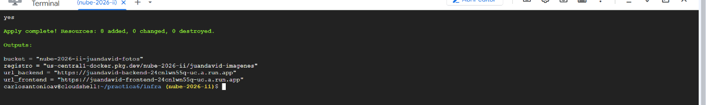

**Qué pasó con el nombre del bucket.** Volvió a ser `nube-2026-ii-juandavid-fotos`, porque se arma con el proyecto y el prefijo, no al azar. Lo pudimos recrear de inmediato; la guía advierte que un nombre recién borrado puede quedar reservado un rato, y en ese caso habría que esperar o cambiar el prefijo. Las URL de Cloud Run tampoco cambiaron (`juandavid-frontend-24cnlwn55q-uc.a.run.app`), porque dependen del nombre del servicio y del proyecto. Lo que sí se perdió fueron las fotos: la aplicación volvió vacía, como era de esperar.

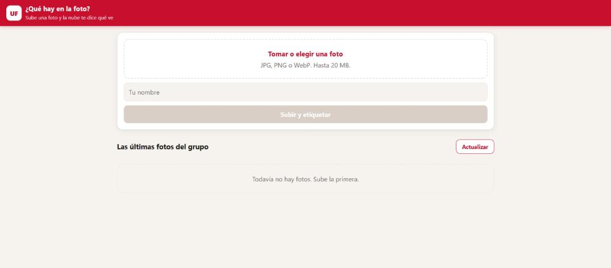

## Preguntas

**¿Por qué la foto de la fase 2 sigue sin etiquetas después de habilitar Vision, y qué tendría que cambiar en el backend para que las tuviera?**

El backend llama a Vision una sola vez, dentro de `POST /fotos`, en el momento de subir. Lo que respondió (en este caso el error 403) quedó escrito en los metadatos de la miniatura: `etiquetas` vacío y `vision: error: 403 ...`. `GET /fotos` solo lee esos metadatos con un listado y nunca vuelve a preguntarle a Vision, así que habilitar la API después no cambia lo que ya estaba guardado. Para que la tuviera, el backend necesitaría una forma de reintentar: por ejemplo una ruta `POST /fotos/<id>/etiquetar`, o un proceso que recorra `miniaturas/` buscando objetos con `vision` distinto de `ok`, descargue la miniatura, llame a `etiquetar` y actualice los metadatos con `blob.patch()`. Cada reintento cuesta una lectura (clase B), las unidades de Vision y una actualización de metadatos (clase A); por eso conviene hacerlo a pedido y no en cada listado de la galería.

**Si le quitan el permiso `storage.objectUser` a la cuenta del backend, ¿qué deja de funcionar, qué ve el usuario y dónde encontrarían el error?**

Deja de funcionar todo lo que toca el bucket, que es todo: `GET /fotos` no puede listar (`storage.objects.list`), `POST /fotos` no puede crear los objetos (`storage.objects.create`) y `GET /fotos/<id>/miniatura` no puede leerlos (`storage.objects.get`). El backend no captura esas excepciones, así que responde 500. El usuario ve que la galería no carga y arriba aparece el aviso "El backend respondió 500"; al subir una foto, el mismo error debajo del botón, y la foto no se guarda. Un detalle: como el backend llama a Vision antes de guardar, la unidad de Vision se gasta igual. El error completo está en los registros del servicio `juandavid-backend` en Cloud Run (o en Logging): una traza con `google.api_core.exceptions.Forbidden: 403` que dice que `juandavid-backend@nube-2026-ii.iam.gserviceaccount.com` no tiene el permiso `storage.objects.list` (o `create`) sobre el bucket. La causa se confirma en la pestaña Permisos del bucket, donde ya no aparece la cuenta. El cambio de IAM tarda un par de minutos en propagarse, así que el efecto puede no ser inmediato.

**¿Por qué el backend le manda a Vision la miniatura y no el original? Den dos razones distintas.**

1. **Tamaño y tiempo de la petición.** La imagen viaja dentro de la petición, en base64, que la agranda un tercio. Un original de 2 MB son unos 2,7 MB de petición; la miniatura, unos 100 KB, 25 veces menos. La subida a Vision es más rápida y el usuario espera menos. Además Vision tiene límites de tamaño por petición (imágenes de hasta 20 MB y JSON de hasta 10 MB), así que una foto grande de teléfono podría ser rechazada; la miniatura nunca se acerca a ese límite.
2. **No mejora el resultado.** Para etiquetar, 1024 píxeles sobran: la documentación de Vision recomienda unos 640×480 para `LABEL_DETECTION`, y más píxeles no le dan más información sobre qué hay en la foto. Además la miniatura ya viene normalizada: girada según el EXIF (un original acostado podría etiquetarse peor), convertida a JPEG aunque el teléfono mande PNG, WebP o HEIC, y sin los metadatos EXIF del original, como la ubicación GPS, que no tienen por qué salir hacia otro servicio. La excepción es el texto muy pequeño, que se lee mejor con más resolución; para eso habría que mandar el original solo a `text_detection`, a costa de una petición más grande.
